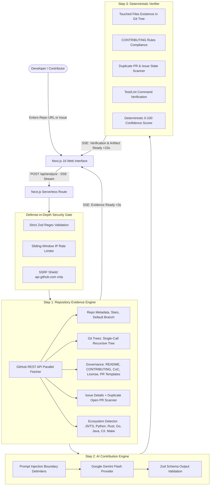

# RepoPilot 🧭
**Autonomous Open-Source Contribution & Developer Workflow Agent**  
*Hackathon Track PS04: Open-Source Contribution and Developer Workflow Agent*  

[](https://github.com/TricksXTech/repopilot/actions/workflows/ci.yml)
[](LICENSE)
[](https://nextjs.org/)
[](https://www.typescriptlang.org/)
[](SECURITY.md)

---

## 5-Line Pitch for Hackathon Judges
> 1. Contributing to open-source is intimidating: 80% of first-time pull requests are rejected due to missed CONTRIBUTING rules, unverified file paths, or failing CI commands.
> 2. **RepoPilot** is an autonomous, security-first developer workflow agent that transforms any public GitHub repository into a verified, step-by-step contribution artifact.
> 3. It reads ground-truth evidence via the GitHub REST API in **under 3 seconds** with zero cloning and zero code execution.
> 4. Powered by prompt-injection-safe Google Gemini Flash, it generates an actionable plan, verified unified diff, repo-templated PR draft, and git checklist.
> 5. Its deterministic verification engine audits touched files against git trees, flags duplicate PRs, verifies test commands, and awards a transparent 0–100 confidence score.

---

## 1. Problem Statement
First-time open-source contributors face steep barriers to entry:
- **Governance Overhead:** Complex `CONTRIBUTING.md`, issue templates, CLA requirements, and PR checklists scattered across `.github/`, `docs/`, or root.
- **Hallucinated Guidance:** Generic AI tools frequently hallucinate non-existent files, invent fake functions, or suggest deprecated test runners.
- **Workflow Friction:** Finding which test suite to run, matching the repository's commit convention (e.g. Conventional Commits vs imperative), and avoiding duplicate pull requests consumes hours.
- **Security Risks:** Downloading and executing third-party code locally exposes contributors to supply-chain attacks.

---

## 2. PS04 Hackathon Track Mapping

| Core Theme | PS04 Requirement | How RepoPilot Solves It |
| :--- | :--- | :--- |
| **1. Repository Evidence** | Read-only extraction of repository governance, structure, workflows, and issue state. Zero cloning. | Single recursive git-trees call, multi-location governance discovery (`README`, `CONTRIBUTING`, `CODE_OF_CONDUCT`, PR/Issue templates, `LICENSE`), language breakdown, open PR duplicate scanner, commit message style analyzer, and multi-ecosystem command detector (JS/TS, Python, Rust, Go, Java, Ruby, PHP, .NET, Makefile). |
| **2. Contribution Artifact** | High-precision, actionable contributor guide with diff, PR draft, and commands. | Plain-language issue summary, exact file touch plan, syntax-highlighted unified diff (`suggested, review before use`), PR title/description populated with the repo's actual PR template, commit message following repository convention, step-by-step terminal checklist, markdown download, and 1-click clipboard actions. |
| **3. Verification Engine** | Deterministic claim verification with source links, audit badges, and confidence scoring. | Automated cross-referencing: validates every touched file against real git tree blobs, audits `CONTRIBUTING.md` rules, flags duplicate open PRs, verifies test/lint command presence, confirms issue availability, links every claim to GitHub source URLs, and calculates a 0–100 confidence score with itemized deductions. |

---

## 3. Architecture & System Flow



---

## 4. Security & Safety Model

RepoPilot was built security-first:
1. **SSRF Protection:** Target URLs are constructed strictly on `https://api.github.com/repos/{owner}/{repo}/...`. Arbitrary host calls, non-GitHub URLs, localhost (`127.0.0.1`), AWS metadata (`169.254.169.254`), and path traversal attempts (`..`, `%2e`) are rejected at the edge.
2. **Zero Code Execution & Zero Cloning:** RepoPilot never clones repositories or executes untrusted third-party code. All inspections occur over HTTPS using GitHub's read-only REST API.
3. **Prompt Injection Defense:** Untrusted repository contents (README, issue comments, code snippets) are isolated inside `<untrusted_repo_content>` boundary tags with strict system directives prohibiting command execution or instruction-following. LLM outputs are validated against strict Zod schemas.
4. **Secrets & Hygiene:** API credentials (`GEMINI_API_KEY`, `GITHUB_TOKEN`) exist only in server-side environment variables and are never sent to the client, logged, or serialized into error responses.
5. **Content Security Policy:** Strict CSP in `next.config.ts` without `unsafe-eval`, HSTS enabled for 2 years, `frame-ancestors 'none'`, and `Permissions-Policy` disabling camera, microphone, and geolocation.
6. **Rate Limiting:** Sliding-window in-memory rate limiting per IP (30 req / 10 min) with HTTP 429 friendly headers.

---

## 5. Technology Stack
- **Framework:** Next.js 16.4.3 (App Router, Turbopack, Serverless Route Handlers)
- **Language:** TypeScript 5.x (Strict mode)
- **Styling:** Tailwind CSS v4, Lucide Icons
- **Validation:** Zod 4.x
- **LLM Provider:** Google Gemini API (`gemini-2.5-flash` / isolated provider with deterministic fallback)
- **Testing:** Vitest 5.x (Unit, Security, and E2E API tests)
- **Deployment:** Vercel Serverless

---

## 6. Quick Start & Setup

### Prerequisites
- Node.js 20+ or 22+
- npm 10+

### Installation
```bash
# 1. Clone repository
git clone https://github.com/TricksXTech/repopilot.git
cd repopilot

# 2. Install dependencies (pinned lockfile)
npm ci

# 3. Configure environment
cp .env.example .env.local
```

### Environment Variables (`.env.local`)
```env
# Required: Free Gemini API Key from https://aistudio.google.com/
GEMINI_API_KEY=your_gemini_api_key_here

# Optional: GitHub Personal Access Token (Read-Only: public_repo)
# Increases rate limit from 60 req/hr to 5,000 req/hr
GITHUB_TOKEN=
```

### Run Locally
```bash
# Start development server
npm run dev

# Open http://localhost:3000
```

### Testing & Audits
```bash
# Run unit & security tests (28 tests across validation, verifier, ecosystem, and e2e)
npm test

# Run ESLint
npm run lint

# Run production build
npm run build

# Run dependency vulnerability audit
npm audit
```

---

## 7. 60-Second Demo Script

| Time | Action | What Judges See / Hear |
| :--- | :--- | :--- |
| **0:00 - 0:10** | **The Hook** | *"Welcome to RepoPilot. Making a first open-source contribution is notoriously tricky because you have to learn new governance rules, find test commands, and avoid duplicate PRs."* |
| **0:10 - 0:25** | **Live Input & Speed** | Paste `https://github.com/colinhacks/zod` and click **Analyze Repo**. Within **2.1 seconds**, the **Repository Evidence** card appears, displaying TypeScript ecosystem detection, `npm test` / `npm run lint`, CONTRIBUTING files, and top 5 Good First Issues. |
| **0:25 - 0:40** | **Contribution Artifact** | In under **12 seconds**, the **Contribution Artifact** streams in: a plain-language issue summary, exact files to modify, a syntax-highlighted unified diff, a PR description following the repo's PR template, and 1-click terminal commands. |
| **0:40 - 0:55** | **Deterministic Verification** | Show the **Verification Report Card**: confidence score of **100/100**. Highlight that every touched file was verified against the real git tree, no duplicate open PR was found, and every claim links directly to GitHub. |
| **0:55 - 1:00** | **Wrap-Up & Security** | *"RepoPilot did all this with zero cloning, zero code execution, and prompt-injection defense. Download the plan as Markdown with one click. Thank you!"* |

---

## 8. GitHub Repository Configuration Checklist
For production deployment, enable the following in repository settings:
- [x] **Secret scanning with Push Protection:** Prevents accidental commits of API keys.
- [x] **Dependabot Security Updates:** Automated pull requests for outdated packages.
- [x] **Branch Protection on `main`:** Require CI checks (`audit-lint-test-build`) to pass before merging.

---

## 9. Future Scope
- **Interactive Multi-File Diff Editor:** In-browser fine-tuning of diff proposals before exporting.
- **GitHub OAuth App Integration:** Optional 1-click fork and draft PR creation directly from the UI.
- **Monorepo Workspace Scoping:** Automatic sub-package detection and localized test filtering for Lerna/Turborepo/Nx.

---

## 10. License
Licensed under the [MIT License](LICENSE).
